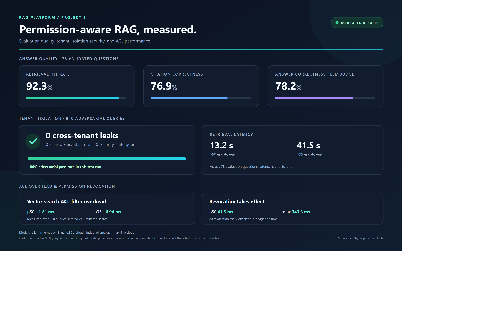
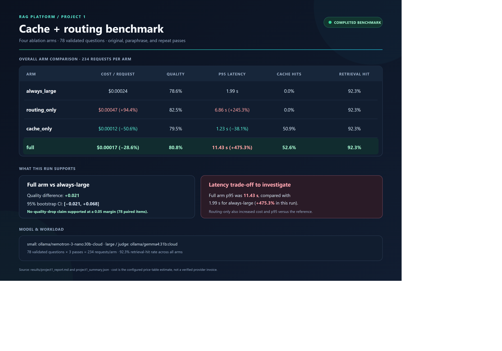

# RAG Platform: measurable RAG → multi-tenant security → cost/latency → multi-hop GraphRAG

One service that evolves through four stages, each evaluated against the previous one.
Source spec: *RAG Build Guides* (baseline → Project 2 → Project 1 → Project 3).

> **Status: Baseline + Project 2 + Project 1 implemented (78+ offline tests). Project 3 (GraphRAG) is next.** Project 2 result artifacts are available below; see [docs/EXPERIMENTS.md](docs/EXPERIMENTS.md) for experiment status and limitations.

## Architecture
See [docs/ARCHITECTURE.md](docs/ARCHITECTURE.md) (Mermaid diagrams). Stack: FastAPI · Qdrant · sentence-transformers · LiteLLM · Postgres · (Streamlit, Neo4j in later phases).

## The story
1. **Baseline** - plain RAG (≈500-token chunks w/ overlap, top-5, citations) with full request instrumentation and a repeatable eval.
2. **Project 2** - permission-aware multi-tenant RAG: JWT identity, ACL metadata on every chunk, **pre-retrieval** Qdrant filter + second app-level check, append-only audit log, instant permission revocation, adversarial leakage suite (target: zero leaks).
3. **Project 1** - tenant-aware semantic cache (tenant ∧ role-set ∧ corpus_version ∧ TTL ∧ threshold, live-ACL re-check, purge on ACL change) + rule-based small/large routing with escalation + benchmark with a statistical no-quality-drop gate + Streamlit dashboard. See [docs/project1/README.md](docs/project1/README.md).
4. **Project 3** *(planned)* - Neo4j knowledge graph + hybrid graph/vector retrieval + cross-encoder rerank on HotpotQA.

Answers must cite numbered context passages. If generation omits a valid citation,
the service makes one correction attempt per request; if the answer is still
uncited, it is returned with no citations and is not added to the Project 1 cache.

## Results (generated by scripts - never hand-edited)
| System | Retrieval hit | Quality (judge) | Cost/req | p95 | Security | EM/F1 |
|---|--:|--:|--:|--:|--:|--:|
| Baseline | TBD | TBD | TBD | TBD | n/a | n/a |
| Project 2 | 92.3% | 78.2% | $0.00* | 41.5 s | 0 / 840 leaks | n/a |
| Project 1 (full arm) | 92.3% | 80.8% | $0.00017* | 11.43 s | see Project 2 | n/a |
| Project 3 | - | - | TBD | TBD | - | TBD |

Project 2 evaluation, security, and ACL measurements (from the saved result
artifacts; values are specific to those runs):



*Cost figures are configured price-table estimates, not verified provider
invoices. Project 2's local Ollama model entries are recorded as $0.00/request. See
[results/project2-results.svg](results/project2-results.svg) for the
resolution-independent version and [docs/EVALUATION.md](docs/EVALUATION.md)
for metric definitions.

Project 1 benchmark (78 validated questions, three passes per arm):



The full arm reduced estimated cost/request by 28.6% versus always-large, with
the quality non-inferiority claim supported at a 0.05 margin. Its p95 latency
was 11.43 s (+475.3% vs. always-large), so the trade-off is visible rather
than hidden. All four arms had 92.3% retrieval hit rate in this run. Cost is a
configured estimate, not a provider invoice. See the
[generated benchmark report](results/project1_report.md) and
[scalable SVG](results/project1-results.svg) for details.

## Setup & usage
### Windows PowerShell

Create and activate the virtual environment, install dependencies, and start
the services:

```powershell
python -m venv .venv
.\.venv\Scripts\Activate.ps1
python -m pip install -r requirements.txt
Copy-Item .env.example .env
docker compose up -d
```

The Makefile selects `cmd.exe` for Windows recipes. If your GNU Make
installation exposes the command as `mingw32-make`, use that in place of
`make` (for example, `mingw32-make install`). If neither command is found,
install GNU Make or add its executable directory to `PATH`, then open a new
PowerShell window.

With the virtual environment active, project targets can be run from
PowerShell:

```powershell
make install
make up
make corpus
make ingest-baseline
make api
```

`make api` starts the baseline API; use `make p1` instead to start Project 1.
Run either API target in its own terminal and leave it running.

### macOS / Linux

```bash
python -m venv .venv && source .venv/bin/activate && make install
cp .env.example .env            # set JWT_SECRET and a provider key (or LLM_MODEL=ollama/llama3.1)
make up                         # Qdrant + Postgres

# Baseline
python -m scripts.fetch_corpus               # or put 50-200 .txt/.md files in data/raw/
make ingest-baseline
python -m scripts.create_eval_set --path data/raw --n 80 --doc-prefix acme
python -m scripts.create_eval_set --review data/eval/eval_set.jsonl     # hand-validate!
make eval-baseline                           # -> results/baseline.csv + baseline_summary.json
make api                                     # http://localhost:8000/docs   (SYSTEM=baseline for no-auth mode)

# Project 2
make tenants && make ingest-tenants          # 3 fictional tenants x 8 docs (public/internal/confidential)
python -m scripts.issue_token --user hr@helios
curl -s localhost:8000/query -H "Authorization: Bearer $TOKEN" -H 'content-type: application/json' -d '{"query":"What is the salary band for engineers?"}'
make p2                                      # start API in Project 2 (JWT + ACL) mode
make security                                # pytest tests/security + results/project2_security.json (exit 1 on any leak)
make measure-p2                              # filter overhead + revoke propagation
python -m scripts.run_evaluation --system project2 --tenant acme --user eval@acme --roles employee

# Project 1
make tune-cache                              # threshold sweep 0.85-0.97 on 50+50 pairs -> results/cache_threshold_sweep.json
make eval-router                             # router accuracy (dev); use --split test once, --split stress to see the weakness
make paraphrases                             # LLM paraphrases for the benchmark (review by hand)
make bench                                   # always_large vs routing/cache/full -> results/project1_report.md
make p1                                      # API with cache + routing (SYSTEM=project1)
make dashboard                               # Streamlit, reads request_log
```
In PowerShell, capture and send the token like this (the `curl` command above
uses Unix curl syntax; PowerShell's `curl` is usually an alias for
`Invoke-WebRequest`):

```powershell
$TOKEN = (python -m scripts.issue_token --user hr@helios).Trim()
$headers = @{ Authorization = "Bearer $TOKEN" }
$body = @{ query = "What is the salary band for engineers?" } | ConvertTo-Json
Invoke-RestMethod -Uri "http://localhost:8000/query" -Method Post `
  -Headers $headers -ContentType "application/json" -Body $body
```

For Wikipedia API access, set `WIKIPEDIA_USER_AGENT` to identify your application
and include a real contact address. In PowerShell, for example:
`$env:WIKIPEDIA_USER_AGENT = "rag-platform/0.2 (contact: your-email@example.com)"`
Replace the example address with your own. The fetcher spaces requests one
second apart; if Wikimedia still returns HTTP 403, wait and follow the bot-traffic
guidance in its response rather than retrying rapidly.

Admin endpoints: `GET /admin/audit/documents/{doc_id}?days=30` (who retrieved doc X) · `PUT /admin/documents/{doc_id}/acl` (revocation).

## Tests
`pytest -q` → 79 tests (unit, integration, security, evaluation). Run offline with `EMBEDDER_BACKEND=hash`.
**Caveat:** offline runs use in-process Qdrant + stub LLM; real-stack results must be regenerated before reporting.

## Layout
`app/` (api, core, retrieval, generation, security, observability, services, evaluation) · `scripts/` · `tests/{unit,integration,security,evaluation}` · `docs/` · `configs/`

## Limitations / future work
See [docs/LIMITATIONS.md](docs/LIMITATIONS.md) and [docs/DECISIONS.md](docs/DECISIONS.md).
