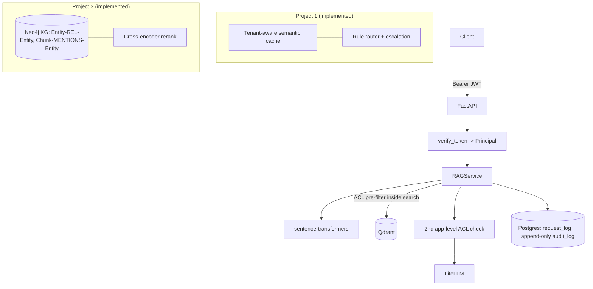

# Architecture

One service that gains capability phase by phase. Nothing is forked; each phase is a layer on `RAGService`.



## Status by phase
| Phase | State |
|---|---|
| Baseline (ingest, chunk, embed, top-5, cite, FastAPI, eval, instrumentation) | **Implemented and evaluated on a saved 60-question run** |
| Project 2 (JWT, ACL payload, pre-filter, 2nd check, audit, revocation, adversarial suite) | **Implemented; saved 840-query security suite reported zero leaks; see result caveats in README and LIMITATIONS** |
| Project 1 (tenant-aware cache, router, escalation, dashboard, benchmark) | **Implemented and benchmarked; cache sweep found no zero-false-hit threshold, and router stress accuracy was 25%** |
| Project 3 (GraphRAG: extraction, resolution, Neo4j graph, hybrid retrieval, rerank, HotpotQA eval) | **Implemented and evaluated on 180 questions with saved Neo4j-backed results; full live Neo4j contract-suite pass is not recorded** |

## Secure request flow (Project 2)
```mermaid
sequenceDiagram
  participant U as User
  participant A as API
  participant Q as Qdrant
  participant L as LLM
  participant D as Postgres
  U->>A: POST /query {query} + JWT
  A->>A: verify JWT -> (user_id, tenant_id, roles)  [body identity ignored]
  A->>Q: vector search WITH ACL filter (tenant must; role/user should)
  Q-->>A: authorized candidates only
  A->>A: 2nd check per chunk (fail-closed); violations -> audit + alert
  A->>L: prompt = only chunks that passed both checks
  A->>D: request_log + audit_log(+audit_document)
  A-->>U: answer + citations + sources
```
Failure paths: bad/expired token -> 401; non-admin on admin route -> 403; foreign/unknown doc on admin route -> 404
(existence never revealed); zero authorized chunks -> fixed "I don't know" with **no LLM call**.

## Data stores
- **Qdrant** `chunks`: vector + payload (`tenant_id, document_id, chunk_index, text, classification, allowed_roles, allowed_users, corpus_version`), keyword payload indexes on the ACL fields.
- **Postgres/SQLite**: `request_log` (instrumentation), `audit_log` + `audit_document` (append-only via DB triggers).

## Project 1 flow
See [docs/project1/README.md](project1/README.md) for the cache / routing / escalation flowchart and the security reasoning.
Cache hits skip retrieval, so validity carries the authorization context (tenant, role-set hash, corpus_version, TTL) and a live ACL re-check runs on every hit.

## Project 3 flow
See [docs/project3/README.md](project3/README.md): build pipeline (extraction -> resolution -> Neo4j), hybrid retrieval, graph security model, and what is/isn't verified.
Graph failure paths: unknown/ungrounded entity -> rejected and counted; question with no linkable entity -> graph contributes nothing and the system degrades to vector + rerank; graph-only chunk missing from Qdrant -> empty payload -> denied by the second check.
