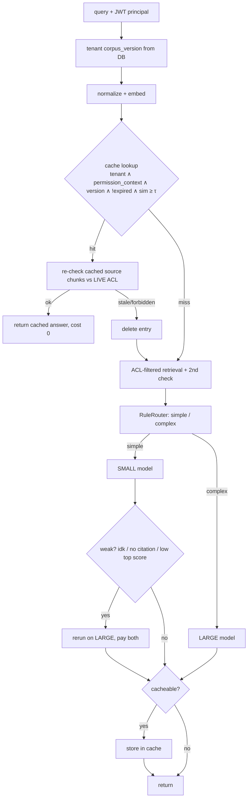

# Project 1 — Semantic cache + cost-aware routing
**Scope (per PDF):** semantic cache, rule-based small/large routing, escalation, Streamlit dashboard. No DAGs, no LLM router, no agents.

## Request flow (`RAGService._answer_p1`)

## Why the cache is tenant/permission-aware
A semantic cache returns an answer **without running retrieval**, so it bypasses Project 2's ACL filter entirely. Anything stored
under a loose key is a data-leak primitive. Controls (each independently tested):
1. `tenant_id` hard filter. 2. `permission_context` = hash(tenant, exact role set) — a superset of roles is a *different* context.
3. Entries built from chunks the user saw **only via a per-user grant** are `user_specific` → reusable by that user only.
4. `corpus_version` per tenant (content hash; re-ingest of changed docs changes it; unchanged re-ingest and other tenants' ingests do not).
5. TTL (`CACHE_TTL_SECONDS`). 6. **Live ACL re-check** of cached source chunks on every hit. 7. `PUT /admin/documents/*/acl` **purges the tenant's cache**.
8. Never cached: empty, "I don't know", `model=="none"`, source-less answers.

## Router & escalation
Signals: word count, trigger keywords (why/compare/explain/…), entity-count proxy, multi-part, and — at request time — top retrieval score and score spread.
Escalation (simple→LARGE retry) on: "I don't know" phrase, zero citations, top score < `ESCALATION_MIN_TOP_SCORE`. Retrieval is reused; **both calls are billed** in the logged cost.
**Known weakness (E1):** accuracy collapses on adversarial queries; see EXPERIMENTS.md.

## Ablations
`CACHE_ENABLED`, `ROUTING_ENABLED` flags give the four benchmark arms. Routing off ⇒ always LARGE (the cost reference).

## Run
```bash
make p1                                                  # cache + routing live
python -m scripts.tune_cache_threshold                    # sweep; then set CACHE_THRESHOLD
python -m scripts.eval_router --split dev                 # (test only once, after freezing config)
python -m scripts.make_paraphrases && python -m scripts.run_benchmark --tenant acme --user eval@acme --roles employee --only-validated
streamlit run dashboard/app.py                            # reads request_log
```

The saved threshold sweep found no zero-false-hit value on its 50 paraphrase / 50 near-miss pairs. Do not treat any threshold as safe based on that sweep; see [EXPERIMENTS.md](../EXPERIMENTS.md).
