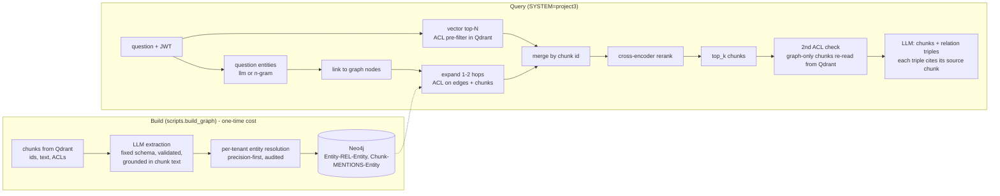

# Project 3 — GraphRAG for multi-hop questions
**Scope (per PDF):** LLM extraction into a fixed Pydantic schema → entity resolution → Neo4j graph → hybrid vector + graph retrieval (1–2 hops) → cross-encoder rerank → answer with citations. Evaluated against plain vector RAG on HotpotQA, multi-hop **and** single-hop, with indexing cost reported.
**Not in scope / not built:** question decomposition (optional in the spec; see LIMITATIONS), agents, DAGs.

## Why vector search alone fails on bridge questions
"Where was the director of *Film X* born?" needs two facts in two documents. Paragraph A names the director but not the birthplace; paragraph B names the birthplace but never mentions Film X. Embedding the question retrieves A (it shares words with the question) and rarely B. The graph connects them: `Film X —DIRECTED_BY→ Dana Reed —BORN_IN→ Lisbon`, so seeding at "Film X" and expanding 1–2 hops reaches B's chunk.

## Pipeline


## Components (all under `app/graph/`)
| File | Responsibility | Key safeguard |
|---|---|---|
| `schema.py` | 8 entity types, 19 relation types (Literals) | LLM may not invent types; known synonyms are aliased, anything else is **rejected and counted** |
| `extraction.py` | prompt → JSON → validated `ChunkExtraction` | per-item validation (one bad item never poisons the chunk); entity must literally occur in the chunk (grounding); relation endpoints must be validated entities; `evidence_chunk_id` is set by **our code**, never the LLM; 1 retry on invalid JSON |
| `resolution.py` | merge surface forms of one real entity | same type only; exact normalised match, else string rule **AND** embedding gate; ambiguous names left unmerged and logged; match against the cluster representative only (no chaining); every decision recorded |
| `build.py` | extraction (cached, threaded) → resolution → load | raw LLM output cached and re-validated on load (rebuilds free, schema fixes free); reports **total** indexing cost incl. cached calls |
| `store.py` | `GraphStore` contract; `InMemoryGraphStore`, `Neo4jGraphStore` | tenant namespacing; edge ACL; hub cap; refuses to load a graph that crosses tenants |
| `linking.py` | question → graph seeds | LLM mode requires each name to occur in the question; n-gram mode costs no LLM call |
| `rerank.py` | cross-encoder (`ms-marco-MiniLM-L-6-v2`) | `LexicalReranker` exists for offline tests only |
| `hybrid.py` | the retrieval algorithm above | vector retrieval is never replaced; `graph_enabled=False` gives the vector+rerank ablation |

## Security: a graph is an easy way around ACLs
Project 2 filters chunks. A graph adds a second access path: entities and relations. Controls (each mutation-tested, see EXPERIMENTS E5):
1. Entities are tenant-namespaced; expansion never leaves the caller's tenant (seed + edges + chunks).
2. Every edge carries the **union of its evidence chunks' ACLs**; it is traversable only if the caller could read ≥1 evidence chunk. Otherwise a restricted paragraph would still "connect" two entities and leak reachability.
3. Returned chunks are ACL-filtered inside the graph query, then **re-checked in application code** against the **Qdrant** payload (not the graph's copy, which is the data the graph filter itself used).
4. `PUT /admin/documents/{id}/acl` updates Qdrant **and** the graph (chunk nodes + recomputed edge ACLs).
5. `load()` refuses cross-tenant edges, mentions, or evidence.
6. Hub cap: never walk *through* an entity with more than `GRAPH_HUB_DEGREE_CAP` neighbours.

## Evaluation design (`app/evaluation/p3_eval.py`, `scripts/run_p3_eval.py`)
Same service, same short-answer prompt, same `top_k`; **only retrieval differs**.
| arm | what it is | what it isolates |
|---|---|---|
| `vector` | Project-2 path, plain top-k | the baseline |
| `vector_rerank` | vector top-10 → cross-encoder → top-k | the reranker's own contribution |
| `hybrid` | vector + graph (LLM question entities) → rerank → top-k + triples | GraphRAG |
| `hybrid_ngram` | as `hybrid`, question entities by dictionary match | the value of the LLM call |
Metrics: EM, token-F1 (citations stripped first), supporting-fact **paragraph** recall, all-supporting-found, candidate recall (pool before rerank), $/query, p50/p95. Deltas vs `vector` are **paired** with 95% bootstrap CIs, per slice (multi-hop, bridge, comparison, single). The report prints "improvement SUPPORTED" only if the CI lower bound is above 0, and "no harm SUPPORTED" on the single-hop slice only if it is above −0.05.

## What has been verified, and what has not
| | Status |
|---|---|
| Extraction validation, resolution rules, graph semantics (in-memory), hybrid logic, ACL/tenant controls, eval plumbing | ✅ Unit/integration tests; security controls mutation-tested |
| Graph construction and hybrid retrieval on Neo4j | ✅ Saved build and evaluation artifacts record `graph_backend=neo4j`; generated reports include non-stub results |
| Full Neo4j store contract suite | ⚠️ The saved reports do not establish that all 12 live contract tests passed. Run `make neo4j-up` and `make test-neo4j` to verify the complete contract suite |
| HotpotQA evaluation | ✅ 180 validated questions (120 multi-hop, 60 single-hop); results and configuration are saved under `results/` |
| Generalization beyond this dataset | ⚠️ Not established. The dataset is modest and uses HotpotQA's distractor setting; see [LIMITATIONS.md](../LIMITATIONS.md) |

## Run
```bash
make neo4j-up                                 # + make up for Qdrant/Postgres
make test-neo4j                               # FIRST: contract tests against the real Cypher
make hotpot && make ingest-hotpot             # 120 stratified questions + their paragraphs (CC BY-SA 4.0)
make build-graph                              # extraction + resolution + load; writes results/graph_build_report.json (indexing cost)
#   REVIEW results/graph_resolution_audit.json by hand (merges, ambiguous names, rejection examples)
make singlehop
# Review questions_single.jsonl against each source document; set validated=true only for verified questions.
make p3-eval                                  # results/project3_{report.md,summary.json,csv}
make p3-ablate-resolution                     # E6: graph without resolution (order matters; see Makefile)
make p3                                       # JWT-protected hybrid retrieval
```
`SYSTEM=project3` keeps JWT, ACL, audit and revocation but does **not** enable the Project 1 cache/router (the evaluation isolates retrieval).
